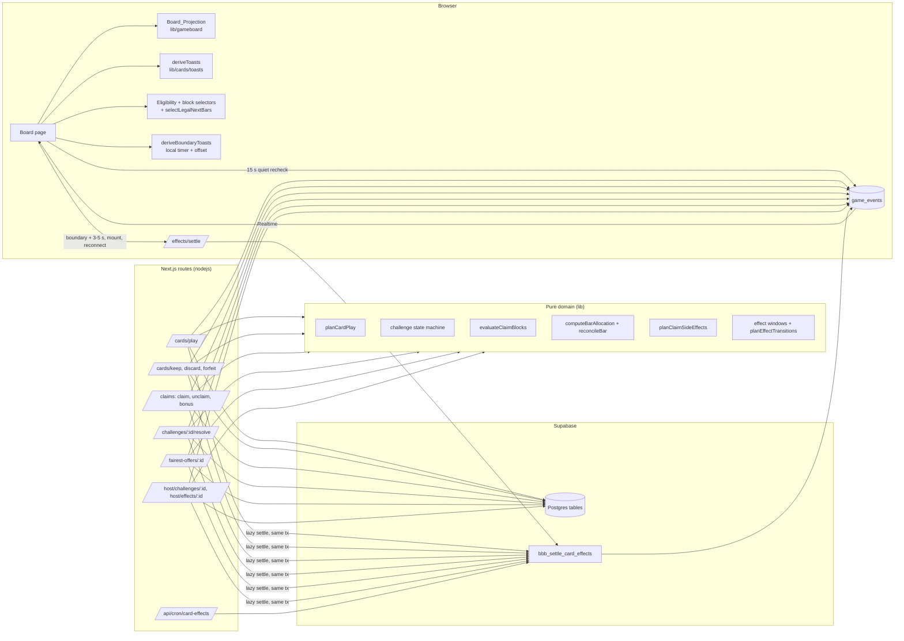

# Design Document: card-behavior

## Overview

This design makes all 23 Brawl Deck cards do what `cards.md` and `game-rules.md` say. It
builds on what already exists:

- `POST /cards/play` removes a card from hand and appends `card_played` with targets.
- `POST /claims` writes the claim, base share ledger entries, the draw, and (for the
  finish bar) the game end in one transaction, appending several events.
- `score_ledger_entries` is append-only; scores are sums.
- The board folds `game_events` into `GameBoardView` with a `seq` watermark.
- Every mutation locks the `games` row `FOR UPDATE` (via `assertMember` / `assertAdmin` /
  `endGame`), so mutations on one game are already serialized.

The design adds four durable records (challenges, Fairest offers, effects, effect awards),
a set of pure domain modules that decide everything, thin server persistence that executes
their plans, new and extended routes, a projection section that folds the new records, and
UI for toasts, prompts, map overlays, and host overrides.

Key decisions:

1. **Pure planners, thin routes.** Every card rule lives in a framework-free module that
   takes a loaded `BehaviorState` snapshot plus server time and returns a plan or a
   `Stable_Error`. Routes load state, call the planner, write the plan, and append events.
   The UI calls the same eligibility and block selectors, so what it grays out is what the
   server rejects.
2. **Records embedded in events.** New mutations embed full row snapshots of every changed
   challenge, offer, effect, award, and score entry in their event payload. The reducer
   upserts them by id. This keeps Challenge, Host, Bonus_Claim, and Timer_Sweep mutations at
   exactly one event each, and keeps the existing multi-event claim and play transactions
   unchanged in shape.
3. **Bar reconciliation instead of share deltas.** Shares are computed as a target
   allocation for a bar (normal rule, Party Crasher phantom, Insurance floors) and diffed
   against what the ledger currently holds for that bar. Card awards use separate categories
   that reconciliation never touches.
4. **Lazy server time for correctness, local timers for toasts, settlement for the log.**
   Claims, plays, and resolutions evaluate effects against a server timestamp read after the
   game lock. Boards render start and end Boundary_Toasts locally from `startsAt` / `endsAt`
   plus the measured Server_Clock_Offset. Activation and expiry events come from one
   idempotent SQL function, `bbb_settle_card_effects`, which has no scheduler of its own.
   It runs only when called: by the member-scoped Settle_Nudge that boards call
   after each boundary and on mount or reconnect, lazily inside every Card_Behavior_Mutation
   before the plan, and by the optional `CRON_SECRET` route. Each transition is announced
   exactly once.
5. **Stable error vocabulary.** New rejections use the `Stable_Error` set from the
   card-implementation plan. Existing play-route reasons are migrated to it.
6. **One Legal_Next_Bar rule.** A pure `selectLegalNextBars` / `hasLegalNextBar` helper is the
   only definition of "this team still has somewhere to go" under next-claim restrictions.
   `planCardPlay`, the eligibility selectors, `decideFairest`, and the picker and Fairest
   prompt all call it.
7. **Recheck behind Realtime.** Boards refetch snapshot plus tail on reconnect and, while the
   game is live, fetch events after their last seq whenever 15 s (one Recheck_Interval) pass
   with no new event, so a committed event reaches every connected projection within the
   Delivery_Bound (the Recheck_Interval plus fetch latency and clock-offset error).

## Architecture



### Mutation pipeline (all card-behavior routes)

```
withTransaction(tx):
  1. authorize (assertMember / assertAdmin)      -- locks games row FOR UPDATE
  2. now = select clock_timestamp()               -- server time read AFTER the lock
  3. settled = select bbb_settle_card_effects(gameId, true, now)
                                                  -- lazy Timer_Sweep, same tx, same lock (19.9)
  4. state = loadBehaviorState(tx, gameId, now)   -- one snapshot, sees the settled flags
  5. plan  = pureFunction(state, request, now)    -- or Stable_Error
  6. if rejected: return (commit: transition events only, no domain rows)
  7. writePlan(tx, plan)                          -- rows
  8. appendEvent(s) with embedded records         -- same tx, seq after the transition events
catch -> rollback (domain rows, mutation events, AND step-3 transition events),
         respond { applied:false, error:"unavailable" } (503)
```

Reading `clock_timestamp()` after the lock, rather than `now()` (transaction start), makes
server time agree with lock order: a mutation that waits for the lock evaluates effects at
the moment it actually runs.

**Lazy settlement choice.** Settlement runs inside the mutation transaction, after the game
lock and before the plan, with the same `now` the plan uses (the `p_now` argument). This is
the literal reading of 19.9 ("under the game lock before the mutation is evaluated"), and it
guarantees 20.3b: any boundary at or before the mutation's `now` is announced, with its
transition events ordered before the mutation's own events. Consequences, stated once and
relied on everywhere else (19.10):

- The "exactly one `game_events` entry" counts in 5.2, 7.2, 8.3, 9.4, 9.5, 13.5, 19.6, and
  21.7 count **mutation events**: events whose `event_type` is not `effect_activated` /
  `effect_expired`. A mutation response's `seq` is its last mutation event.
- "Write nothing" for a rejection means **no domain rows and no mutation events**. A rejected
  mutation may still commit transition events (and the `start_announced_at` /
  `end_announced_at` flips that back them), because those are due regardless of the
  mutation. The settlement call is a no-op for a game that is not live, so `conflict` on a
  non-live game commits nothing at all.
- A thrown error rolls back the step-3 transition events too. That is safe: they are
  re-derived by the next settle call, and correctness never depended on them.
- Route tests assert counts over mutation events only, and assert that the settle call
  precedes `loadBehaviorState`.

### Timer settlement (no database scheduler)

The Supabase project has no in-database scheduler and will not enable one. Vercel Hobby cron is roughly daily. Boundary toasts therefore come from the
board's local timer (see Projection Changes), and the event log is settled by these callers
of the same SQL function:

| Trigger | Cadence | Auth | Role |
| --- | --- | --- | --- |
| `POST /api/games/{gameId}/effects/settle` (Settle_Nudge) | every connected board, on mount, on reconnect, and 3 s after each known boundary plus 0-2 s jitter (within 5 s, 20.8) | member session, own game only (20.5b) | Primary: announces due transitions while anyone is connected; returns `serverNow` for the clock offset (20.9) |
| Lazy, inside every Card_Behavior_Mutation (step 3 above) | every claim, bonus, play, inventory change, resolution, Fairest decision, and host override | the mutation's own auth | Guarantees 20.3b: nothing due is unannounced after the next mutation |
| `GET/POST /api/cron/card-effects` (Cron_Route) | optional external scheduler; not configured by default | `CRON_SECRET` bearer, fails closed (20.5a) | Optional catch-up for games with no connected board |

While no board for a game is connected, nothing calls settle except mutations and the
optional Cron_Route, so Boundary_Toasts and transition-event appends carry no timing
guarantee (20.3d). Once a transition event is committed, its delivery to boards that are
connected follows the recheck bound (23.8) like any other event. Claim, play, and
bonus rules stay correct because they evaluate against server time, not events (20.3c).

Exactly-once is enforced three ways:

1. Each transition is claimed with a conditional update under the game lock:
   `update card_effects set end_announced_at = clock_timestamp() where id = $1 and end_announced_at is null returning id`.
   Only the transaction that flips the marker appends the event.
2. A partial unique index on `game_events (game_id, (payload->>'effectId'), event_type)`
   for `effect_activated` / `effect_expired` makes a duplicate append impossible.
3. The pure model `planEffectTransitions` (property-tested) is the specification the SQL
   function mirrors; an integration test checks they agree.

The Settle_Nudge takes only a game id and can only announce transitions whose boundary is at
or before the server time read after the game lock (20.5c). It cannot change game state. The
secret requirement (20.5a) applies only to the Cron_Route. The Settle_Nudge runs in its own
transaction; lazy settlement runs inside the mutation transaction as described above.
Concurrent callers serialize on the game lock, so whichever runs first flips the marker and
the rest append nothing (20.4). Correctness never depends on settlement having run.

## Components and Interfaces

### 1. Card text catalog (`lib/cards/cardText.ts`)

Replaces `placeholderCardText` and the old `CardText` in `catalog.ts`. `catalog.ts`
re-exports `getCardText` so imports stay stable.

```ts
export type TemplatePlaceholder =
  | "Caster" | "Target" | "CARD" | "Bar"
  | "color1" | "color2" | "color3"
  | "duration" | "cuisine" | "startTime" | "endTime";

export interface CardToastOverrides {
  readonly announcement?: string;   // replaces the others' headline for non-casters (all-teams toast)
  readonly othersBody?: string;     // Crop Dusting others' body
  readonly start?: string;          // Cancel Culture start toast
  readonly end?: string;            // timed end toast
  readonly payout?: string;         // Patient Investor
  readonly mirrorHeadline?: string; // Fairest mirror toast to original caster
  readonly mirrorOthersHeadline?: string;
  readonly fairestPrompt?: string;
  readonly actions?: { readonly complete: string; readonly failed?: string };
}

export interface CardText {
  readonly requires: string | null;
  readonly effect: string;
  readonly targetNote: string;
  readonly targetToastBody: string | null;
  readonly toasts?: CardToastOverrides;
}

export function createCardText(
  entries: Readonly<Record<CardSlug, CardText>>,
): ReadonlyMap<CardSlug, CardText>; // throws on blank effect/targetNote, or blank
                                     // targetToastBody for team-target cards (1.4)
export function getCardText(slug: CardSlug): CardText;
```

Strings are copied from `docs/card-text-oracle.md` with line wraps joined by single spaces.
The Fairest entry carries the new prompt wording. Voted Off the Island's `targetToastBody`
is the oracle's target toast body.

Catalog metadata changes (1.7):

- Happy Hour: `resolution: "none"`, `completionRequired: false`.
- Pioneer, Scenic Route: `completionRequired: false` (they currently inherit `true`).
- New derived helpers: `isGatedCard(meta)` (`completionRequired && targetMode === "team"`)
  and `isMirrorableCard(meta)` (`targetMode === "team"`).

Consumers of `description` / `castingRequirement` / `targetRequirement` (`CardsRegion`,
`CardPlayPanel`, `catalog.test.ts`) switch to the new fields (1.5).

### 2. Templates and formatting (`lib/cards/templates.ts`)

```ts
export type TemplateValues = Partial<Record<TemplatePlaceholder, string>>;
export function renderTemplate(template: string, values: TemplateValues): string;
export function templatePlaceholders(template: string): TemplatePlaceholder[];
export function formatDuration(seconds: number): string;      // 90 -> "1:30"
export function parseDuration(text: string): number | null;   // "1:30" -> 90
export function formatClockTime(iso: string, timeZone?: string): string; // "h:mm AM/PM", viewer TZ
export function remainingMs(endsAtIso: string, serverNowMs: number): number; // clamped >= 0
```

`renderTemplate` substitutes in a single pass, so a value containing `{Bar}` is never
re-expanded. Unknown placeholders are left in place and rejected by a catalog test.

### 3. Casting input validation (`lib/cards/inputs.ts`)

```ts
export const ROYGBIV = ["red","orange","yellow","green","blue","indigo","violet"] as const;
export type CastingParams =
  | { readonly kind: "none" }
  | { readonly kind: "colors"; readonly colors: readonly [Color, Color, Color] }
  | { readonly kind: "duration_seconds"; readonly seconds: number }
  | { readonly kind: "cuisine"; readonly cuisine: string };

export function validateCastingInput(
  input: CardInput, raw: unknown,
): { ok: true; params: CastingParams } | { ok: false; error: "invalid_input" };
```

Rules: exactly three distinct ROYGBIV colors (case-insensitive, normalized to lowercase,
order preserved); integer seconds in [0, 300]; cuisine trimmed to 1-60 characters.

### 4. Geodesic distance (`lib/map/geo.ts`)

```ts
export interface LatLng { readonly lat: number; readonly lng: number }
export const EARTH_RADIUS_MILES = 3958.7613;
export const CANCEL_CULTURE_RADIUS_MILES = 0.25;
export function haversineMiles(a: LatLng, b: LatLng): number;
export function withinMiles(a: LatLng, b: LatLng, miles: number): boolean; // inclusive (<=)
export function parseBarLocation(text: string | null): LatLng | null;     // "lat,lng"
```

Bar coordinates come from `bars.location`; when null, the bar is matched to
`CANDIDATE_BARS` by key. A bar with no resolvable coordinates is ineligible for
distance-based targets and is never blocked by a radius lock. A Scenic Route claim of a bar
without coordinates is blocked, and the details carry reason `no_coordinates`.

### 5. Bar resolution (`lib/map/barResolver.ts`, server)

The claim route's inline bar lookup moves into a shared helper used by claims, play, and
host routes:

```ts
export interface ResolvedBar {
  readonly barId: string;      // bars.id (uuid)
  readonly barKey: string;     // board-facing key: candidate slug, else uuid
  readonly name: string;
  readonly coords: LatLng | null;
  readonly kind: "start" | "finish" | "scoring";
}
export async function resolveGameBar(tx: QueryRunner, gameId: string, key: string): Promise<ResolvedBar | null>;
```

It matches by uuid, then by the exported TypeScript `slug()` from `lib/map/bars.ts` (the
current SQL regex keeps apostrophes as `-s-`, so it disagrees with the candidate slugs), and
materializes a candidate bar on first touch like the claim route does today. Every event
payload uses `barKey`.

### 6. Effect windows (`lib/cards/effects.ts`)

```ts
export type EffectKind =
  | "bar_lock"                // Crop Dusting
  | "radius_lock"             // Cancel Culture
  | "team_claim_block"        // Everyone's a Critic failure
  | "next_claim_restriction"  // Pioneer, Scenic Route (params.rule)
  | "score_protection"        // Insurance
  | "bonus_window"            // Happy Hour
  | "phantom_share"           // Party Crasher
  | "claim_counter"           // Patient Investor
  | "draw_override";          // Power Hour

export interface EffectRecord {
  readonly effectId: string;
  readonly slug: CardSlug;
  readonly kind: EffectKind;
  readonly sourcePlayId: string | null;
  readonly sourceChallengeId: string | null;
  readonly ownerTeamId: string | null;     // caster / protected / counting team
  readonly targetTeamId: string | null;    // restricted / blocked team
  readonly targetBarKey: string | null;
  readonly startsAt: string;               // ISO, server time
  readonly endsAt: string | null;          // null = until consumed/cancelled
  readonly params: Readonly<Record<string, unknown>>;
  readonly attachedClaimId: string | null; // Insurance after attach
  readonly attachedBarKey: string | null;
  readonly protectedPoints: number | null;
  readonly consumedAt: string | null;
  readonly cancelledAt: string | null;
  readonly cancelReason: "host" | "game_ended" | "protection_released" | null;
  readonly startAnnounced: boolean;
  readonly endAnnounced: boolean;
}

export const DURATIONS_MS = {
  cropDusting: 15 * 60_000,
  cancelCultureDelay: 15 * 60_000,
  cancelCultureLock: 15 * 60_000,
  criticBlock: 15 * 60_000,
  happyHour: 60 * 60_000,
  powerHour: 20 * 60_000,
} as const;

export type EffectPhase = "pending" | "active" | "ended";
export function effectPhase(e: EffectRecord, tMs: number): EffectPhase;
export function isEffectActive(e: EffectRecord, tMs: number): boolean;
// active iff startsAt <= t < endsAt (or endsAt null)
//   and (cancelledAt null or t < cancelledAt) and (consumedAt null or t < consumedAt)
export function drawOverrideActive(effects: readonly EffectRecord[], tMs: number): boolean;

export type EffectTransition = { effectId: string; kind: "activated" | "expired"; atMs: number };
export function planEffectTransitions(
  effects: readonly EffectRecord[], nowMs: number, lifecycle: "lobby" | "live" | "ended",
): EffectTransition[];

// Boundary_Toast schedule shared by the board timer and deriveBoundaryToasts.
export type BoundaryKind = "start" | "end";
export interface Boundary { readonly effectId: string; readonly kind: BoundaryKind; readonly atMs: number }
export function toastBoundaries(effects: readonly EffectRecord[]): Boundary[];
// start: Cancel Culture radius_lock only (start toast, 12.6)
// end:   bar_lock, radius_lock, bonus_window, draw_override with a non-null endsAt
//        that was not cancelled or consumed at or before endsAt (no end toast for host
//        or game-end cancellation, 20.6)
export function nextBoundaryAfter(effects: readonly EffectRecord[], serverNowMs: number): Boundary | null;
```

`planEffectTransitions` rules (mirrored by the SQL function):

- The game must be live.
- Activation is due when `!startAnnounced`, `startsAt <= now`, and the effect was not
  cancelled before `startsAt`. Effects that start immediately are inserted with
  `start_announced_at = created_at`, so only Cancel Culture produces activation events.
- Expiry is due when `!endAnnounced`, `endsAt <= now`, the effect was not consumed, and it
  was not cancelled before `endsAt`. A delayed effect's activation is ordered before its
  expiry.
- Transitions are ordered by `atMs`, then `effectId`.

Host early end is planned by a pure `planHostEffectEnd(state, effectId, now): Plan<HostEffectPlan>`
in this module (`cancelled_at = now`, `cancel_reason = 'host'`, bars to reconcile, protections
to release; already ended/consumed/cancelled → `already_resolved`), called by
`POST /host/effects/{effectId}` (21.4-21.6).

Power Hour overlap (17.3) is the union of active windows: `drawOverrideActive` is true when
any non-cancelled override is active, so overlapping plays stay active until the latest end.

### 7. Challenge state machine (`lib/cards/challenges.ts`)

```ts
export type ChallengeStatus = "open" | "completed" | "failed" | "cleared_by_host";

export interface ChallengeRecord {
  readonly challengeId: string;
  readonly slug: CardSlug;
  readonly sourcePlayId: string;
  readonly casterTeamId: string;
  readonly targetTeamId: string;
  readonly params: CastingParams;
  readonly mirroredFromChallengeId: string | null; // Mirrored_Challenge marker
  readonly mirroredFromPlayId: string | null;
  readonly status: ChallengeStatus;
  readonly createdAt: string;
  readonly resolvedAt: string | null;
  readonly resolvedByTeamId: string | null;
  readonly resolvedBySessionId: string | null;
  readonly resolvedByKind: "team" | "host" | "system" | null;
  readonly failureEffectId: string | null;
}

export type FairestOfferStatus = "pending" | "played" | "declined" | "void";
export interface FairestOfferRecord {
  readonly offerId: string;
  readonly sourcePlayId: string;
  readonly slug: CardSlug;                 // the mirrorable card
  readonly holderTeamId: string;           // original target
  readonly originalCasterTeamId: string;
  readonly challengeId: string | null;     // gated cards
  readonly restrictionEffectId: string | null; // Pioneer / Scenic
  readonly status: FairestOfferStatus;
  readonly decidedAt: string | null;
  readonly mirroredChallengeId: string | null;
  readonly mirroredEffectId: string | null;
}

export type ResolveRequest =
  | { kind: "complete"; actorTeamId: string | null }
  | { kind: "fail"; actorTeamId: string | null };

export function resolveChallenge(
  state: BehaviorState, challengeId: string, req: ResolveRequest, now: string,
): Plan<ChallengeResolutionPlan>;
export function decideFairest(
  state: BehaviorState, offerId: string, decision: "play" | "decline",
  actorTeamId: string | null, now: string,
): Plan<FairestPlan>;
export function hostChallengeOverride(
  state: BehaviorState, challengeId: string, action: "clear" | "reset", now: string,
): Plan<HostChallengePlan>;
export function useItOrLoseItShouldComplete(hand: number, pending: number): boolean;
export function checkCannotPlayDiscard(
  state: BehaviorState, teamId: string,
): Plan<null>; // conflict when the team's open UIOLI challenge has a pending offer (5.5)
export function settleInventoryChange(
  state: BehaviorState, teamId: string, after: DeckState, now: string,
): InventoryFollowUp; // UIOLI completions + offers voided because Fairest left hand
```

`Plan<T> = { ok: true; plan: T } | { ok: false; error: StableError; details?: object }`.

Transition table:

| From | Action | Guard | To | Side effects |
| --- | --- | --- | --- | --- |
| open | complete | actor on target team, no pending offer, slug ≠ UIOLI | completed | none |
| open | fail | slug = everyone's-a-critic, actor on target team, no pending offer | failed | `team_claim_block` for target team, `[now, now+15m)` |
| open | (inventory) | slug = UIOLI, hand = 0 and pending = 0 | completed (`resolvedByKind: "system"`) | embedded in the inventory event |
| open | host clear | host | cleared_by_host | voids pending offer on this challenge |
| completed / failed | host reset | host; UIOLI also needs a non-empty hand or a pending draw | open | failed critic: cancel `failureEffectId` |
| any other | complete / fail | | | `already_resolved` |
| any | complete / fail | actor not on target team | | `not_authorized` |
| open with pending offer | complete / fail | | | `conflict` |
| open UIOLI with pending offer | "Can't play, discard" (`/cards/discard`, `reason: "cannot_play"`) | | | `conflict` (5.5) |

Resetting a Use It or Lose It challenge whose target already has an empty hand and no
pending draw is rejected with `conflict`, because the challenge could never complete again.
Resetting `cleared_by_host` is rejected with `conflict`.

A "pending offer" means an offer with status `pending` whose holder still has Fairest of
Them All in hand. The holder check uses the inventory, so a stale offer never blocks
resolution.

Fairest decision (`decideFairest`):

- `decline`: offer becomes `declined`.
- `play`: the holder must still hold Fairest in hand (else `conflict`) and the offer must be
  pending (else `already_resolved`). For a Pioneer or Scenic Route offer, the planner then
  re-runs `mirrorIsLegal(state, offer, now)` (Component 9a). If the original caster would
  have no Legal_Next_Bar, Play is rejected with `invalid_input`, details
  `{ reason: "no_legal_next_bar", rules }`, nothing is written, and the offer stays
  `pending` so Decline remains available (9.16, 9.17). Fairest moves `hand → played`. The planner creates a
  Mirrored_Challenge on the original caster with the same slug and `params` (or, for
  Pioneer/Scenic, a mirrored `next_claim_restriction` on the original caster). It voids every
  other pending offer for the holder (9.13) and leaves the original challenge untouched
  (9.8). A mirrored UIOLI challenge is created `completed` when the caster's hand is already
  empty with no pending draw.
- Mirrored records never produce offers (9.10).

### 8. Card-play planner (`lib/cards/playPlan.ts`)

```ts
export interface PlayRequest {
  readonly cardId: string;
  readonly casterTeamId: string;
  readonly targetTeamId?: string;
  readonly targetBarKey?: string;
  readonly rawParams?: unknown;
}

export interface PlayPlan {
  readonly slug: CardSlug;
  readonly params: CastingParams;
  readonly targetBar: ResolvedBarRef | null;
  readonly challenges: readonly ChallengeRecord[];
  readonly offers: readonly FairestOfferRecord[];
  readonly effects: readonly EffectRecord[];
  readonly revokeClaims: readonly { claimId: string; reason: "voted_off" }[];
  readonly releaseProtections: readonly string[]; // effect ids
  readonly reconcileBars: readonly string[];      // bar keys
  readonly inventoryFollowUp: InventoryFollowUp;  // caster's own hand change (UIOLI on caster, Fairest leaving)
}

export function planCardPlay(state: BehaviorState, req: PlayRequest, now: string): Plan<PlayPlan>;
```

Validation order: game live (`conflict`), card in caster's hand (`conflict`), Fairest via
normal play (`invalid_input`), casting input (`invalid_input`), target mode, target
eligibility (`invalid_input`), then the per-card resolver.

Per-card resolvers (registry keyed by slug; one function each):

| Card(s) | Eligibility | Records |
| --- | --- | --- |
| Gated team cards (11) | team ≠ caster, in game, same-name rule | open challenge (UIOLI: `completed` if target hand and pending are empty); offer if target holds Fairest |
| Pioneer / Scenic Route | same as team cards, plus `hasLegalNextBar(target, existing ∪ {new rule})` (10.10, 10.11) | `next_claim_restriction` on target (`params.rule = "pioneer" \| "scenic"`); offer only if target holds Fairest **and** `hasLegalNextBar(originalCaster, casterExisting ∪ {same rule})` at the play's `now` (9.15) |
| Crop Dusting | bar ≠ finish | `bar_lock`, owner = caster, `[now, now+15m)` |
| Cancel Culture | `haversine(bar, finish) > 0.25` | `radius_lock`, `[now+15m, now+30m)`, `params.radiusMiles = 0.25` |
| Happy Hour | bar ≠ finish | `bonus_window`, `[now, now+60m)` |
| Party Crasher | bar ≠ finish, active claimants < 4 | `phantom_share` (no end); reconcile bar |
| Insurance | none | `score_protection`, owner = caster, unattached |
| Patient Investor | none | `claim_counter`, owner = caster, `params.counted = []` |
| Power Hour | none | `draw_override`, `[now, now+20m)` |
| Voted Off the Island | bar ≠ start and every team in the game has an active claim on it; team ≠ caster | revoke target's active claim on bar (`voted_off`); release any Insurance attached to that claim; reconcile bar |

The existing bar rule ("not already targeted by a card of the same name") stays. The
same-name team rule counts only `card_played` facts, so Mirrored_Challenges never count
against it (9.14).

A Pioneer or Scenic Route play on a team with no Legal_Next_Bar is rejected with
`invalid_input`, details `{ reason: "no_legal_next_bar", rules }`, and the card stays in the
caster's hand. When the target holds Fairest but the mirror would leave the caster with no
Legal_Next_Bar, the play still succeeds and simply creates no offer.

### 9. Eligibility selectors (`lib/gameboard/cardEligibility.ts`, extended)

The existing selectors gain a context so the play panel and `planCardPlay` share one rule
set:

```ts
export interface CardTargetContext {
  readonly finishBarKey: string | null;
  readonly startBarKey: string | null;
  readonly barCoords: ReadonlyMap<string, LatLng>;
  readonly claimState: ClaimState;      // bar key -> active claimant team ids
  readonly teamIds: readonly string[];
}
export type BarIneligibilityReason =
  | "finish_bar" | "start_bar" | "already_targeted_same_card"
  | "near_finish" | "no_coordinates" | "four_claimants" | "not_claimed_by_all";
export function selectBarTargetEligibility(
  view: GameBoardView, slug: CardSlug, barKeys: readonly string[], ctx: CardTargetContext,
): BarTargetEligibility[];
export type TeamIneligibilityReason =
  | "caster" | "already_targeted_same_card" | "no_legal_next_bar";
export function selectTeamTargetEligibility(
  view: GameBoardView, slug: CardSlug, castingTeamId: string, ctx: CardTargetContext,
  teams?: readonly BoardTeamView[],
): TeamTargetEligibility[]; // { teamId, eligible, reason?, rules? }
```

`planCardPlay` builds the same `GameBoardView` (folded in-transaction, as the play route
does today) and `CardTargetContext` from durable rows and calls these selectors.
`CardTargetContext` gains `previousBars: ReadonlyMap<teamId, ResolvedBarRef>` and
`restrictions: ReadonlyMap<teamId, readonly NextClaimRule[]>` (unconsumed, uncancelled
`next_claim_restriction` rules per team) so the team selector can call `hasLegalNextBar`.
For Pioneer and Scenic Route, a team is ineligible with reason `no_legal_next_bar` when
`hasLegalNextBar(team, its rules ∪ {played rule})` is false (10.10-10.12, 22.5).

### 9a. Legal next bars (`lib/claims/legalNextBar.ts`)

The single definition of Legal_Next_Bar, shared by `planCardPlay`, the eligibility selectors,
`decideFairest`, the Pioneer/Scenic picker, the Fairest prompt, and `evaluateClaimBlocks`'
restriction checks.

```ts
export type NextClaimRule = "pioneer" | "scenic";

export interface LegalNextBarInput {
  readonly teamId: string;
  readonly rules: readonly NextClaimRule[];          // existing restrictions plus any candidate
  readonly bars: readonly ResolvedBarRef[];          // every game bar (key, kind, coords)
  readonly finishCoords: LatLng | null;
  readonly activeClaims: readonly { teamId: string; barKey: string }[];
  readonly previousBar: ResolvedBarRef;              // previousBarFor(teamId, ...)
}

/** Pure per-rule check, also used by evaluateClaimBlocks so blocks and legality agree. */
export function barSatisfiesRule(
  rule: NextClaimRule, bar: ResolvedBarRef, input: LegalNextBarInput,
): boolean;
// pioneer: no team other than input.teamId holds an active claim on bar
// scenic:  bar.coords and finishCoords and previousBar.coords are known, and
//          haversine(bar, finish) > haversine(previousBar, finish)

export function selectLegalNextBars(input: LegalNextBarInput): string[]; // bar keys, sorted
// bar.kind !== "finish"
//   && no active claim by input.teamId on bar
//   && every rule in input.rules: barSatisfiesRule(rule, bar, input)
// Temporary locks (Crop Dusting, Cancel Culture, critic blocks, Challenge_Gate) are ignored.

export function hasLegalNextBar(input: LegalNextBarInput): boolean; // selectLegalNextBars(...).length > 0

export function mirrorIsLegal(
  state: BehaviorState, offer: Pick<FairestOfferRecord, "slug" | "originalCasterTeamId">, now: string,
): boolean; // true for non-restriction slugs; for Pioneer/Scenic:
            // hasLegalNextBar(caster, caster's active rules ∪ {offer's rule})
```

Rules:

- `rules` is a set: duplicates are ignored, so stacking two of the same rule is no stricter
  than one. Stacking Pioneer and Scenic Route requires one bar satisfying both (10.11).
- The start bar is a candidate like any other non-finish bar. It is excluded in practice by
  "not actively claimed by the team" once the team has claimed it, and by Scenic Route when it
  is the previous bar.
- With an empty `rules` list, any non-finish bar the team does not hold is legal.
- `evaluateClaimBlocks` calls `barSatisfiesRule` for its `pioneer` / `scenic` blocks; the
  finish-bar Pioneer block and the Scenic `no_coordinates` reason stay as in Component 10.
  This makes "claim of bar b is not restriction-blocked and b is non-finish and not held"
  equivalent to "b is in `selectLegalNextBars`".
- The guard is evaluated at play time and at Fairest Play time only. A team can still become
  stuck later (for example when other teams claim the last unclaimed bars after Pioneer);
  the Host ends the restriction effect to unstick it (21.11).

UI:

- **Pioneer/Scenic picker:** teams with `reason: "no_legal_next_bar"` are grayed with the
  label "No legal next bar for this team" plus the rules involved (for example "already under
  Pioneer"), keyboard-focusable with `aria-disabled` (10.12).
- **Fairest prompt (Pioneer/Scenic):** the board re-evaluates `mirrorIsLegal` on every render
  from the current view. While it is false, the prompt shows "Mirroring is no longer legal:
  {Caster} would have no legal next bar." with Play disabled and Decline enabled (9.18). If
  the server still rejects Play with `invalid_input`, the error is shown inline and the
  prompt stays open.

### 10. Claim blocks (`lib/claims/blocks.ts`)

```ts
export type ClaimBlock =
  | { kind: "challenge"; slug: CardSlug; challengeId: string }
  | { kind: "critic_block"; slug: "everyones-a-critic"; effectId: string; endsAt: string }
  | { kind: "bar_lock"; slug: "crop-dusting"; effectId: string; endsAt: string }
  | { kind: "radius_lock"; slug: "cancel-culture"; effectId: string; endsAt: string }
  | { kind: "pioneer"; slug: "pioneer"; effectId: string; reason: "finish_bar" | "claimed_by_other" }
  | { kind: "scenic"; slug: "scenic-route"; effectId: string; reason: "not_farther" | "no_coordinates" };

export interface ClaimBlockInput {
  readonly teamId: string;
  readonly bar: ResolvedBarRef;              // key, kind, coords
  readonly finishCoords: LatLng | null;
  readonly challenges: readonly ChallengeRecord[];
  readonly effects: readonly EffectRecord[];
  readonly activeClaims: readonly { teamId: string; barKey: string }[];
  readonly previousBar: ResolvedBarRef;       // from previousBarFor
  readonly barCoords: ReadonlyMap<string, LatLng>;
  readonly mode: "claim" | "bonus";           // bonus skips next-claim restrictions (10.7)
  readonly nowMs: number;
}
export function evaluateClaimBlocks(input: ClaimBlockInput): ClaimBlock[];
// Defined in lib/claims/legalNextBar.ts (avoids a circular import) and re-exported here.
export function previousBarFor(
  teamId: string,
  claimHistory: readonly { teamId: string; barKey: string; claimedAt: string; revokedReason: string | null }[],
  startBar: ResolvedBarRef,
): ResolvedBarRef; // latest claim not revoked as ordinary_unclaim; start bar if none
```

All blocks are collected, not short-circuited, so `details.blocks` lists every blocking card
with end times for timed blocks (19.3). The order of checks follows 19.1: challenge gate,
critic block, Crop Dusting, Cancel Culture, next-claim restrictions. Crop Dusting exempts
its owner. Cancel Culture applies to every team, with an inclusive 0.25-mile radius.
Pioneer `claimed_by_other` and Scenic `not_farther` / `no_coordinates` blocks are decided by
`barSatisfiesRule` from Component 9a, so restriction blocks and Legal_Next_Bar never
disagree.

The board uses the same function for its blocked-claim message and map overlays (10.9,
11.6, 12.8).

### 11. Scoring allocation (`lib/scoring/allocation.ts`)

```ts
export const SHARE_CATEGORIES = ["bar_share", "bar_share_correction", "finish_award"] as const;
export const AWARD_CATEGORIES = [
  "happy_hour_bonus", "happy_hour_bonus_reversal", "patient_investor_award",
] as const;

export interface BarAllocationInput {
  readonly barKind: ClaimScoringBarKind;
  readonly claimantTeamIds: readonly string[];          // active, 0..4
  readonly phantom: boolean;                            // active Party Crasher on this bar
  readonly protectedFloors: ReadonlyMap<string, number>; // team -> protected points (attached Insurance)
}
export function computeBarAllocation(input: BarAllocationInput): ReadonlyMap<string, number>;
export function currentBarHoldings(
  entries: readonly LedgerEntry[], barId: string,
): ReadonlyMap<string, number>; // sums SHARE_CATEGORIES only
export function reconcileBar(
  holdings: ReadonlyMap<string, number>,
  target: ReadonlyMap<string, number>,
  isInitialClaim: (teamId: string) => boolean,
): ScoreAdjustment[]; // nonzero diffs, sorted by team id
```

Allocation rules:

- Start bar: everyone gets 0.
- Finish bar: the single claimant gets 12.
- Scoring bar with `n` claimants: `base = 12 / (n + (phantom && n < 4 ? 1 : 0))`. This is
  always an integer for n in 1..4.
- Each claimant gets `max(base, protectedFloors.get(team) ?? 0)`. Others get `base` (15.4).

`reconcileBar` emits `bar_share` for a team with zero prior holdings, and
`bar_share_correction` otherwise. The existing `computeShareAdjustments` is kept as a thin
wrapper over allocation and reconciliation (no phantom, no floors) so its tests keep passing.
Award categories are never part of holdings, so Happy Hour and Patient Investor awards
survive every share change, Voted Off removal, and host override (13.8, 16.5, 18.7, 21.6).

### 12. Claim side effects (`lib/cards/claimEffects.ts`)

```ts
export interface ClaimSideEffects {
  readonly consumeEffects: readonly string[];      // next_claim_restriction for team (10.6)
  readonly attachProtection: { effectId: string; protectedPoints: number } | null; // 15.2
  readonly happyHourAward: { effectId: string } | null;   // +5 (13.3)
  readonly counterUpdates: readonly { effectId: string; counted: readonly CountedClaim[]; payout: boolean }[];
  readonly drawOverride: boolean;                  // Power Hour (17.2)
}
export function planClaimSideEffects(state: BehaviorState, claim: NewClaim, allocationAfter: ReadonlyMap<string, number>, nowMs: number): ClaimSideEffects;

export interface UnclaimSideEffects {
  readonly reverseAwards: readonly string[];       // HH awards with claim_id = this claim (13.9)
  readonly uncount: readonly { effectId: string; counted: readonly CountedClaim[] }[]; // 16.3
  readonly releaseProtections: readonly string[];  // Insurance attached to this claim (15.5)
}
export function planUnclaimSideEffects(state: BehaviorState, claimId: string, reason: "ordinary_unclaim" | "voted_off"): UnclaimSideEffects;
```

Rules:

- **Insurance:** the oldest unattached, uncancelled `score_protection` owned by the team
  attaches to the claim. `protectedPoints` equals the team's allocation right after this
  claim.
- **Happy Hour:** for each active `bonus_window` on the bar where the team has no unreversed
  award, add +5 (13.3, 13.6).
- **Patient Investor:** each active `claim_counter` owned by the team appends
  `{claimId, barKey}` unless that bar key is already counted. On reaching 4 it pays out +6
  and is consumed in the same transaction, including when the claim is the finish bar (16.4).
- **Ordinary unclaim:** reverses Happy Hour awards from that claim (`happy_hour_bonus_reversal`,
  −5), removes the claim from unpaid counters, and releases attached protection.
- **Voted Off removal:** only releases protection. Awards and counters are unchanged (18.7).

### 13. Toasts and audience routing (`lib/cards/toasts.ts`)

```ts
export type ToastKind =
  | "target" | "caster" | "others" | "announcement" | "start" | "end" | "payout"
  | "mirror" | "mirror_others" | "fairest_prompt" | "host_override" | "voted_off_target";

export type ToastAction =
  | { kind: "mark_complete"; challengeId: string }
  | { kind: "we_failed"; challengeId: string }
  | { kind: "fairest_play"; offerId: string }
  | { kind: "fairest_decline"; offerId: string };

export interface Toast {
  readonly id: string;                // `${seq}:${kind}:${subjectId}` stable
  readonly kind: ToastKind;
  readonly seq: number;
  readonly headline: string;
  readonly body: string | null;
  readonly dropdown: string | null;   // others' toast Effect text
  readonly actions: readonly ToastAction[];
  readonly dismissable: boolean;      // false while actions are pending (3.8)
}

export function audienceRole(
  viewerTeamId: string | null, casterTeamId: string, targetTeamId: string | null,
): "caster" | "target" | "others";
export function deriveToasts(
  view: GameBoardView, viewerTeamId: string | null, opts: { timeZone?: string },
): Toast[];
export function selectPendingActions(view: GameBoardView, teamId: string): ToastAction[];
export const CLAIM_BLOCKED_HEADLINE = "Your team can't claim this bar yet.";
```

Routing rules per `ToastEvent` folded by the projection:

- **Team play:** target → target toast ("{Caster} has played {CARD} on you!" +
  `targetToastBody`); caster → caster toast; everyone else → others' toast with the Effect in
  the dropdown. Voted Off the Island targets get the oracle's removal body.
- **Bar / self / no-target play:** caster → caster toast. Non-casters get the override
  (`announcement`, plus `othersBody` for Crop Dusting) when defined, else the standard
  others' headline (3.4).
- **Boundary_Toasts** (Cancel Culture `start`; Crop Dusting, Cancel Culture, Happy Hour, and
  Power Hour `end`, to all teams, 3.7, 12.6) are not routed from `effect_activated` /
  `effect_expired` events. They come from `deriveBoundaryToasts` (below), keyed by
  `boundary:${effectId}:${start|end}`. There is no end toast for effects cancelled by the
  host or by game end (20.6).
- **Patient Investor payout** → `payout` to all teams.
- **Fairest played:** original caster → `mirror`; uninvolved teams → `mirror_others`; the
  holder gets no mirror toast (it already sees its own challenge).
- **Host override** → `host_override` to all teams: "The host cleared {CARD} for {Target}." /
  "The host reopened {CARD} for {Target}." / "The host ended {CARD} early."
- **Pending action toasts** (target challenge actions, Fairest prompts) are derived from
  current challenge/offer state on every render, so reload and reconnect rebuild them
  (3.9). The Fairest prompt hides Mark complete, We failed, and (for UIOLI) the hand's
  "Can't play, discard" action for that challenge (9.3).
  Pioneer and Scenic Route target toasts have no actions (10.8). UIOLI target toasts have no
  Mark complete; the per-card discard action lives in the hand (8.2).

Dismissal: informational toasts are dismissed locally. A per-game localStorage record keeps
`{ floorSeq, dismissed: string[] }`. `floorSeq` is the snapshot watermark at the device's
first load of the game, so historical informational toasts are not replayed on a late join.
Action toasts are not dismissable.

Boundary_Toasts (`lib/cards/boundaryToasts.ts`, pure):

```ts
export interface BoundaryToastInput {
  readonly effects: readonly EffectRecord[];        // from view.cardBehavior
  readonly playSeqByEffect: ReadonlyMap<string, number>; // seq of the play that created it
  readonly lifecycle: "lobby" | "live" | "ended";
  readonly serverNowMs: number;                     // Date.now() + Server_Clock_Offset
  readonly announced: ReadonlySet<string>;          // boundary ids seen via transition events
  readonly sessionShown: ReadonlySet<string>;       // ids already shown by this board session
  readonly dismissal: { floorSeq: number; dismissed: readonly string[] };
}
export function boundaryToastId(effectId: string, kind: BoundaryKind): string;
export function deriveBoundaryToasts(input: BoundaryToastInput): Toast[];
```

`deriveBoundaryToasts` returns one toast per boundary `b` from `toastBoundaries(effects)`
such that all of these hold:

- `b.atMs <= serverNowMs` (local timer) **or** `boundaryToastId(b)` is in `announced` (event
  fallback when the device clock is off). Either source yields the same id, so the toast is
  shown at most once per board (20.12).
- The id is not in `dismissal.dismissed` (20.10), and the source play's seq is greater than
  `dismissal.floorSeq` (no late-join replay).
- If `lifecycle === "ended"`, the id is already in `sessionShown`. Boundaries that passed
  while the board was away from an ended game are suppressed (20.11).

The board keeps the result in a `Map` keyed by toast id, so re-deriving never duplicates a
visible toast, and adds each shown id to `sessionShown`. Undismissed boundary toasts are
restored on reload (they are the same toast, not a second one). Ordering is by `atMs`, then
id. The board's boundary timer is `setTimeout(nextBoundaryAfter(...).atMs - serverNowMs)`,
re-armed after each fire, after every fold, on `visibilitychange`, and whenever the offset
changes; a toast therefore appears within 2 s of the boundary by corrected device time
(20.3a). A late host cancellation that arrives after the local toast showed cannot retract
it; this is the accepted edge.

### 14. Deck engine change for Power Hour (`lib/cards/deck.ts`)

```ts
export interface DeckState { /* existing */ readonly pendingMode: "choose_one" | "keep_all"; }
export function drawForBar(state, barId, options: { finishBar?: boolean; drawOverride?: boolean }): DeckResult;
```

- With `drawOverride` and room for every drawn card, cards go straight to the hand (current
  behavior).
- With `drawOverride` and not enough room, cards go `pending` with `pendingMode: "keep_all"`.
  `keepCard` moves only the chosen card to the hand, rejecting with `hand_full` when the
  hand is full, so the team plays or discards first (17.2). Pending `discardCard` discards
  only that card. `forfeitDraw` discards every pending card. The draw resolves when nothing
  remains pending.
- `powerHourUntil` / `activatePowerHour` are removed. The claim route passes
  `drawOverride = drawOverrideActive(effects, now)`. `team_decks.pending_mode` persists the
  mode. `team_decks.draw_override_until` becomes unused and is left in place (no destructive
  migration).

### 15. Server persistence (`lib/cards/behaviorStore.ts`)

```ts
export interface BehaviorState {
  readonly gameId: string;
  readonly lifecycle: "lobby" | "live" | "ended";
  readonly nowIso: string;
  readonly teams: readonly { teamId: string; name: string; memberSessionIds: readonly string[] }[];
  readonly hostSessionId: string;
  readonly bars: ReadonlyMap<string, ResolvedBar>;          // by key, materialized + candidate
  readonly startBarKey: string | null;
  readonly finishBarKey: string | null;
  readonly activeClaims: readonly ClaimRow[];
  readonly claimHistory: readonly ClaimRow[];
  readonly hands: ReadonlyMap<string, { hand: readonly CardInstance[]; pending: readonly CardInstance[] }>;
  readonly plays: readonly PlayRow[];
  readonly challenges: readonly ChallengeRecord[];
  readonly offers: readonly FairestOfferRecord[];
  readonly effects: readonly EffectRecord[];
  readonly awards: readonly AwardRecord[];
  readonly ledger: readonly LedgerEntry[];
}
export async function loadBehaviorState(tx: QueryRunner, gameId: string, nowIso: string): Promise<BehaviorState>;
export async function writeChallenges(tx: QueryRunner, rows: readonly ChallengeRecord[]): Promise<void>;
export async function writeOffers(tx: QueryRunner, rows: readonly FairestOfferRecord[]): Promise<void>;
export async function writeEffects(tx: QueryRunner, rows: readonly EffectRecord[]): Promise<void>;
export async function appendLedger(tx: QueryRunner, gameId: string, adjustments: readonly LedgerWrite[]): Promise<ScoreEntryRecord[]>;
export async function reconcileBarsInTx(tx: QueryRunner, state: BehaviorState, barKeys: readonly string[], overrides: AllocationOverrides): Promise<ScoreEntryRecord[]>;
export async function endGameEffects(tx: QueryRunner, gameId: string): Promise<void>; // cancel_reason = game_ended
```

Upserts use `insert ... on conflict (id) do update`, so each write is idempotent within a
transaction. `persistDeckTransition` gains an `eventExtra` merge of the
`InventoryFollowUp` records, so UIOLI completion and offer voiding ride on the inventory
event. `instanceRowId` is exported so `card_plays.card_instance_id` can reference the real
row.

## Route Changes

All new rejections go through `notApplied(reason, details?)`. `LobbyErrorReason` gains the
Stable_Error members with the plan's statuses: `not_authorized` 403, `invalid_input` 400,
`conflict` 409, `blocked` 409, `expired` 409, `already_resolved` 409, `unavailable` 503.
Uncaught errors now respond `unavailable` (503) instead of a raw 500 message (19.5). Success
is `{ applied: true, seq, result? }`, where `seq` is the last event appended.

| Route | Change |
| --- | --- |
| `POST /cards/play` | Body adds `params`. Pipeline: lock, `now`, lazy settle, load state, `planCardPlay`. Writes `card_plays` (slug, targets, params), the deck transition, challenges, offers, effects, claim revocations, released protections, and reconciled ledger entries. Appends `card_played` with embedded records, plus one `claim_removed` for Voted Off. Error mapping: `invalid_card` / `target_ineligible` → `invalid_input`; `not_live` → `conflict` (22.3); card not in hand → `conflict`. |
| `POST /cards/discard` | After the transition, `settleInventoryChange`. UIOLI completion and voided offers are embedded in the single `card_discarded` event (8.3, 8.5, 9.12). Optional `reason: "cannot_play"` is recorded in the payload for the UIOLI action; it is rejected with `conflict` via `checkCannotPlayDiscard` while a Fairest decision is pending on the team's open UIOLI challenge (5.5). |
| `POST /cards/keep`, `/cards/forfeit` | Same follow-up hook. Forfeit can complete UIOLI. Keep honors `keep_all`. |
| `POST /claims` `action: "claim"` | After attestation: `evaluateClaimBlocks(mode: "claim")` → `blocked` with `details.blocks`. Then the claim insert, `planClaimSideEffects`, reconciliation with phantom and floors, award ledger entries, effect updates, the finish-bar end plus `endGameEffects`, and the draw with `drawOverride`. Existing events stay (`claim_recorded`, `score_awarded` / `score_modifier_applied` per entry, `cards_drawn`, `game_ended`). `claim_recorded` embeds the changed effects and awards. |
| `POST /claims` `action: "unclaim"` | `planUnclaimSideEffects`, reconciliation, reversal entries. `claim_removed` embeds the changed effects and awards. |
| `POST /claims` `action: "bonus"` (new) | Requires live game, team, an active claim on the bar (`conflict`), a `bonus_window` on the bar (`not_found`), the window still active (`expired`), no unreversed award (`already_resolved`), and no blocks from `evaluateClaimBlocks(mode: "bonus")` (`blocked`). Writes +5 and the award. Appends exactly one `happy_hour_bonus_claimed` event with `scoreEntries` embedded. No claim, no draw (13.5). |
| `POST /challenges/{challengeId}/resolve` (new) | Body `{ outcome: "completed" \| "failed" }`. `assertMember`, actor team from the session, `resolveChallenge`. One `challenge_resolved` event embedding the challenge and any critic block effect. |
| `POST /fairest-offers/{offerId}` (new) | Body `{ decision: "play" \| "decline" }`. One `fairest_decided` event embedding `cards` (Fairest → played), the mirrored challenge or effect, and every changed offer. Pioneer/Scenic Play re-checks `mirrorIsLegal` at the decision's `now`; failure → `invalid_input` with `details.reason = "no_legal_next_bar"`, no mutation writes, offer stays pending (9.16, 9.17). |
| `POST /host/challenges/{challengeId}` (new) | Body `{ action: "clear" \| "reset" }`. `assertAdmin` (`not_admin` → `not_authorized`). One `host_override_applied` event. |
| `POST /host/effects/{effectId}` (new) | Body `{ action: "end" }`. Sets `cancelled_at = now`, `cancel_reason = 'host'`. Party Crasher: reconcile the bar without phantom. Attached Insurance: release, then reconcile. Next_Claim_Restriction (Pioneer/Scenic): cancelled, so `evaluateClaimBlocks` and `hasLegalNextBar` stop applying it (21.11). Awards untouched. One `host_override_applied` event embedding the effect and score entries (21.4-21.7). An effect that is already ended, consumed, or cancelled → `already_resolved`. |
| `POST /effects/settle` (new, Settle_Nudge) | `assertMember` → `missing_session` / `not_member`, nothing written (20.5b). In its own transaction calls `select bbb_settle_card_effects($1, true)`; the function locks the game and reads `clock_timestamp()` after the lock, so only already-due transitions are appended (20.5c). Returns `{ applied: true, seq, result: { appended, serverNow } }`; `serverNow` is `clock_timestamp()` for the offset (20.9). |
| `GET/POST /api/cron/card-effects` (new, Cron_Route, optional) | `CRON_SECRET` bearer, fails closed when unset (20.5a). Calls `bbb_settle_card_effects(null, false)`. Not added to `vercel.json` crons by default. |
| All Card_Behavior_Mutation routes | Lazy settle at pipeline step 3 (19.9). Transition events are excluded from exactly-one counts and from "write nothing" (19.10). |
| `POST /end`, auto-timeout | `endGame` calls `endGameEffects` before its single `game_ended` append. The SQL auto-timeout sweep is redefined to cancel effects too. |

New route directories live under the existing `app/api/games/[gameId]/` and `app/api/cron/`
trees. No new top-level directories, so `structure.md` stays valid apart from listing the
new cron route.

Security: the new routes use the existing per-game session-header identity. The host routes
and Bonus_Claim are authorization-checked in-transaction. The settle endpoint is
authenticated (member session) and can only emit transitions that are already due. No route
is unauthenticated except the cron route, which requires `CRON_SECRET`.

## Data Models

### Migration `0013_card_behavior.sql` (one begin/commit)

```sql
-- Claims: allow card-driven revocation
alter table claims add constraint claims_revoked_reason_valid
  check (revoked_reason is null or revoked_reason in ('ordinary_unclaim', 'voted_off'));

-- Card plays become the durable play record
alter table card_plays
  add column slug text,
  add column target_bar_id uuid,
  add column target_bar_key text,
  add column params jsonb not null default '{}'::jsonb,
  add constraint card_plays_target_bar_fk foreign key (target_bar_id, game_id)
    references bars (id, game_id) on delete cascade,
  add constraint card_plays_params_object check (jsonb_typeof(params) = 'object'),
  add constraint card_plays_id_game_unique unique (id, game_id);

-- Power Hour keep-all pending mode
alter table team_decks add column pending_mode text not null default 'choose_one'
  check (pending_mode in ('choose_one', 'keep_all'));

create table card_challenges (
  id                          uuid primary key default gen_random_uuid(),
  game_id                     uuid not null references games (id) on delete cascade,
  source_play_id              uuid not null,
  slug                        text not null,
  caster_team_id              uuid not null,
  target_team_id              uuid not null,
  params                      jsonb not null default '{}'::jsonb,
  mirrored_from_challenge_id  uuid,
  mirrored_from_play_id       uuid,
  status                      text not null default 'open'
    check (status in ('open', 'completed', 'failed', 'cleared_by_host')),
  created_at                  timestamptz not null,
  resolved_at                 timestamptz,
  resolved_by_kind            text check (resolved_by_kind in ('team', 'host', 'system')),
  resolved_by_team_id         uuid,
  resolved_by_session_id      text,
  failure_effect_id           uuid,
  constraint card_challenges_play_fk foreign key (source_play_id, game_id)
    references card_plays (id, game_id) on delete cascade,
  constraint card_challenges_caster_fk foreign key (caster_team_id, game_id)
    references teams (id, game_id) on delete cascade,
  constraint card_challenges_target_fk foreign key (target_team_id, game_id)
    references teams (id, game_id) on delete cascade,
  constraint card_challenges_distinct_teams check (caster_team_id <> target_team_id),
  constraint card_challenges_resolution_fields check (
    (status = 'open') = (resolved_at is null)),
  constraint card_challenges_id_game_unique unique (id, game_id)
);
create index card_challenges_open_target_idx
  on card_challenges (game_id, target_team_id) where status = 'open';

create table card_effects (
  id                    uuid primary key default gen_random_uuid(),
  game_id               uuid not null references games (id) on delete cascade,
  source_play_id        uuid,
  source_challenge_id   uuid,
  slug                  text not null,
  kind                  text not null check (kind in (
    'bar_lock', 'radius_lock', 'team_claim_block', 'next_claim_restriction',
    'score_protection', 'bonus_window', 'phantom_share', 'claim_counter', 'draw_override')),
  owner_team_id         uuid,
  target_team_id        uuid,
  target_bar_id         uuid,
  target_bar_key        text,
  starts_at             timestamptz not null,
  ends_at               timestamptz,
  params                jsonb not null default '{}'::jsonb,
  attached_claim_id     uuid,
  attached_bar_id       uuid,
  protected_points      integer,
  consumed_at           timestamptz,
  consumed_by_claim_id  uuid,
  cancelled_at          timestamptz,
  cancel_reason         text check (cancel_reason in ('host', 'game_ended', 'protection_released')),
  start_announced_at    timestamptz,
  end_announced_at      timestamptz,
  created_at            timestamptz not null,
  constraint card_effects_window_valid check (ends_at is null or ends_at > starts_at),
  constraint card_effects_cancel_fields check ((cancelled_at is null) = (cancel_reason is null)),
  constraint card_effects_owner_fk foreign key (owner_team_id, game_id)
    references teams (id, game_id) on delete cascade,
  constraint card_effects_target_team_fk foreign key (target_team_id, game_id)
    references teams (id, game_id) on delete cascade,
  constraint card_effects_target_bar_fk foreign key (target_bar_id, game_id)
    references bars (id, game_id) on delete cascade,
  constraint card_effects_attached_claim_fk foreign key (attached_claim_id, game_id)
    references claims (id, game_id) on delete cascade,
  constraint card_effects_id_game_unique unique (id, game_id)
);
create index card_effects_live_idx on card_effects (game_id, kind)
  where cancelled_at is null and consumed_at is null;
create index card_effects_due_idx on card_effects (starts_at, ends_at)
  where cancelled_at is null and (start_announced_at is null or end_announced_at is null);

create table fairest_offers (
  id                     uuid primary key default gen_random_uuid(),
  game_id                uuid not null references games (id) on delete cascade,
  source_play_id         uuid not null,
  slug                   text not null,
  holder_team_id         uuid not null,
  original_caster_team_id uuid not null,
  challenge_id           uuid,
  restriction_effect_id  uuid,
  status                 text not null default 'pending'
    check (status in ('pending', 'played', 'declined', 'void')),
  decided_at             timestamptz,
  decided_by_session_id  text,
  mirrored_challenge_id  uuid,
  mirrored_effect_id     uuid,
  created_at             timestamptz not null,
  constraint fairest_offers_once unique (source_play_id, holder_team_id),
  constraint fairest_offers_subject check (
    (challenge_id is not null) <> (restriction_effect_id is not null))
);

create table card_effect_awards (
  id                        uuid primary key default gen_random_uuid(),
  game_id                   uuid not null references games (id) on delete cascade,
  effect_id                 uuid not null,
  team_id                   uuid not null,
  kind                      text not null check (kind in ('happy_hour_bonus', 'patient_investor_award')),
  claim_id                  uuid,          -- null for Bonus_Claim
  ledger_entry_id           uuid not null references score_ledger_entries (id) on delete cascade,
  reversed_at               timestamptz,
  reversal_ledger_entry_id  uuid references score_ledger_entries (id) on delete cascade,
  created_at                timestamptz not null,
  constraint card_effect_awards_effect_fk foreign key (effect_id, game_id)
    references card_effects (id, game_id) on delete cascade
);
create unique index card_effect_awards_one_live
  on card_effect_awards (effect_id, team_id) where reversed_at is null;

-- Ledger: link card-effect entries to their source effect
alter table score_ledger_entries add column source_effect_id uuid;
alter table score_ledger_entries add constraint score_ledger_entries_effect_fk
  foreign key (source_effect_id, game_id) references card_effects (id, game_id) on delete cascade;

-- Exactly-once timer announcements (defense in depth)
create unique index game_events_effect_transition_once
  on game_events (game_id, (payload->>'effectId'), event_type)
  where event_type in ('effect_activated', 'effect_expired');

-- RLS: members read; no client writes (same pattern as 0010)
alter table card_challenges enable row level security;
create policy card_challenges_member_select on card_challenges for select using (bbb_is_game_member(game_id));
-- ...same for card_effects, fairest_offers, card_effect_awards; revoke insert/update/delete from anon, authenticated
```

Ledger categories added (values of the existing text column): `happy_hour_bonus`,
`happy_hour_bonus_reversal`, `patient_investor_award`. Base shares keep `bar_share`,
`bar_share_correction`, and `finish_award`.

The board reads none of these tables directly. It folds `game_events`. The tables are the
authoritative current state for server decisions (events are history), as the plan
requires.

### Migration `0014_card_effect_sweep.sql`

One begin/commit. The migration creates no database-side schedule of any kind: no
`cron.schedule` call and no reference to the `cron` schema.

1. `bbb_settle_card_effects(p_game_id uuid default null, p_wait boolean default false, p_now timestamptz default null) returns integer`.
   For each live game with due transitions (all games, or just `p_game_id`):
   - Lock the game row: `for update`, or `for update skip locked` when `p_wait` is false.
     Inside a mutation transaction the row is already locked by the caller, so this is a
     re-entrant no-op.
   - Read `coalesce(p_now, clock_timestamp())`. Mutations pass their own `now` so the sweep
     and the plan agree on one instant; the Settle_Nudge and Cron_Route pass null.
   - For each due transition, ordered by boundary time then id: conditionally set
     `start_announced_at` / `end_announced_at`, and only if a row returned, insert one
     `game_events` row at `max(seq)+1` with actor `system`, `event_type` `effect_activated` /
     `effect_expired`, and payload
     `{effectId, slug, kind, barKey, ownerTeamId, targetTeamId, startsAt, endsAt, effects:[record]}`.
   - Return the count appended.
2. Redefine `bbb_run_auto_timeout_sweep()` to add a CTE that cancels the ended games'
   effects with `cancel_reason = 'game_ended'`.
3. `grant execute` on `bbb_settle_card_effects` only to the server role the routes use;
   `revoke execute ... from anon, authenticated`, so browsers cannot call it via PostgREST.

## Projection Changes (`lib/gameboard`)

`GameBoardView` gains a time-independent section. Time is only an input to selectors, so the
fold stays deterministic and snapshot-equivalent:

```ts
export interface CardBehaviorView {
  readonly plays: Readonly<Record<string, PlayView>>;            // playId -> slug, caster, target, barKey, params, seq, createdAt
  readonly challenges: Readonly<Record<string, ChallengeRecord>>;
  readonly offers: Readonly<Record<string, FairestOfferRecord>>;
  readonly effects: Readonly<Record<string, EffectRecord>>;
  readonly awards: Readonly<Record<string, AwardRecord>>;
  readonly toastEvents: readonly ToastEvent[];                   // descriptors, seq-ordered, deduped by id
}
// GameBoardView.cardBehavior: CardBehaviorView
```

Reducer changes in `applyGameBoardEvent`:

- `applyRecordSections(view, payload)` runs for every event after its type-specific handler.
  It upserts `challenges`, `fairestOffers`, `effects`, and `awards` by id (a later seq
  replaces an earlier one). It folds `scoreEntries` through the existing `applyScoreEntry`
  (deduplicated by `entryId`) and applies `removedClaims` through `applyClaimRemoved`.
- `card_played` also records a `PlayView` and a `ToastEvent { kind: "play" }`.
- New types: `challenge_resolved`, `fairest_decided` (also routed through
  `applyCardInventoryEvent` for its `cards` section), `happy_hour_bonus_claimed`, and
  `host_override_applied`. Each pushes a `ToastEvent` where an audience toast exists.
- `effect_activated` / `effect_expired` set `startAnnounced` / `endAnnounced` from the
  embedded record. They push no toast events; `deriveBoundaryToasts` reads the
  `startAnnounced` / `endAnnounced` flags as its `announced` fallback set. They no longer remove effects from
  a list: `activeEffects`, `activeRestrictions`, `activeChallenges`, and `notifications`
  become selectors over `cardBehavior`, kept as deprecated read-only aliases until their
  tests move.
- `score_awarded` with `category: "patient_investor_award"` pushes a payout toast event.
- `game_ended` marks every uncancelled effect cancelled at the event time with reason
  `game_ended`, matching the server, and drops pending action toasts (lifecycle `ended`
  makes the board read-only).
- Unchanged: the seq watermark (23.2) and the foreign-game `RangeError` (23.5).

Selectors (`lib/gameboard/cardBehavior.ts`):

```ts
selectOpenChallengesFor(view, teamId): ChallengeRecord[];
selectEffectPhases(view, serverNowMs): Array<{ effect: EffectRecord; phase: EffectPhase; remainingMs: number }>;
selectClaimBlocksForBar(view, ctx, teamId, barKey, serverNowMs): ClaimBlock[];  // wraps evaluateClaimBlocks
selectMapOverlays(view, ctx, teamId, serverNowMs): MapOverlay[];  // restricted bars, crop locks (non-owners), cancel zones pending/active, HH badges
selectBonusClaimable(view, teamId, serverNowMs): string[];         // bar keys (13.4)
selectHostItems(view, serverNowMs): HostItem[];                     // every challenge + pending/active effect with valid actions (21.10)
```

`ClaimState` for eligibility comes from `selectClaimState` (existing). Scores remain
`selectScoreTotals`, the sum of ledger entries (23.4).

Server clock offset (`lib/cards/clockOffset.ts`, pure):

```ts
export function measureOffset(sentAtMs: number, receivedAtMs: number, serverNowIso: string): number;
// = Date.parse(serverNow) - (sentAtMs + (receivedAtMs - sentAtMs) / 2)   (20.9)
export function serverNow(deviceNowMs: number, offsetMs: number): number; // deviceNow + offset
```

The board updates the offset from every Settle_Nudge response. Countdowns use
`serverNow(Date.now(), offset)` (20.7). The two board timers, both rescheduled after each
fold, fire, offset change, and `visibilitychange`:

- **Toast timer** at `nextBoundaryAfter(effects, serverNow).atMs`, then re-derives
  Boundary_Toasts (20.3a).
- **Nudge timer** at each known boundary + 3 s + random 0-2 s, plus on mount and reconnect
  (20.8). It never runs while the game is not live.

### Recheck behind Realtime (`lib/realtime/recheck.ts`)

```ts
export const RECHECK_INTERVAL_MS = 15_000;

export interface RecheckDeps {
  readonly fetchEventsAfter: (gameId: string, afterSeq: number) => Promise<GameEvent[]>;
  readonly apply: (events: readonly GameEvent[]) => void;   // existing ordered/deduped fold
  readonly lastSeq: () => number;                           // projection watermark
  readonly isLive: () => boolean;
  readonly scheduler?: Scheduler;                           // from reconnect.ts, fake in tests
}
export class RecheckController {
  constructor(gameId: string, deps: RecheckDeps);
  noteEvent(): void;   // any event applied (Realtime or recheck): restart the 15 s quiet timer
  start(): void;       // arm the timer while live
  stop(): void;        // on unmount or when the game ends
}
```

- The quiet deadline is `lastAppliedCreatedAtMs + 15 s` in server time (event `created_at`,
  compared via the Server_Clock_Offset), or `lastFireMs + 15 s` after a fire, whichever is
  later. `noteEvent` moves the deadline only when the watermark advances contiguously. An
  event that arrives with a seq gap (`seq > lastSeq() + 1`) triggers an immediate fetch
  instead of waiting.
- When the deadline passes with the game live, the controller calls
  `fetchEventsAfter(gameId, lastSeq())` and applies the result through the same seq-ordered,
  deduplicating fold, then re-arms (23.7). A failed fetch re-arms without applying. The pure
  scheduling decision is `nextRecheckAt(state): number | "now" | null` so it can be
  property-tested without timers.
- Reconnect keeps the existing `ReconnectController` / `ResumeController` path, which
  refetches snapshot plus tail and folds it (23.6). The recheck is not a reconnect.
- `SnapshotSource` gains `fetchEventsAfter`, implemented in `supabaseBrowser.ts` as the
  existing select with `.gt("seq", afterSeq).order("seq")`, RLS-scoped like the snapshot.
- Delivery bound (23.8): `seq` and `created_at` are assigned under the game lock, so they
  are monotonic together. For an event committed at `t` that Realtime drops, every
  contiguously applied earlier event has `created_at <= t`, so the quiet-poll deadline never
  moves past `t + 15 s` (one Recheck_Interval); a later event arriving first exposes a gap and
  fetches at once. The fetch returns every event above the watermark, so the dropped event is
  folded within the Delivery_Bound: one Recheck_Interval plus the fetch latency and
  clock-offset error the integration test's 3-attempt retry absorbs.

## UI Changes (`components/board`)

- **`CardsRegion`**: inspection shows Requires (if any), Effect, then the Target note (1.6).
  While the team has an open UIOLI challenge, each held card shows "Can't play, discard",
  which posts `/cards/discard` with `reason: "cannot_play"` (8.2). The action is hidden while
  a Fairest prompt is pending for that challenge (9.3). Fairest of Them All shows
  no Play button and the note "Played from a challenge prompt" (9.11).
- **`CardPlayPanel`**:
  - Adds an input step before targeting for `colors` (seven toggle buttons, exactly three
    required, with an `aria-pressed` state), `duration_seconds` (minutes and seconds number
    inputs, 0:00-5:00, shown as `m:ss`), and `cuisine` (text input, `maxLength=60`, trimmed
    validation).
  - Shows Requires text above the confirm button (6.6).
  - Bar and team graying use the extended selectors with reason labels: "too close to the
    finish", "four teams already claimed", "not claimed by every team", "start bar", and, for
    Pioneer and Scenic Route teams, "No legal next bar for this team" (10.12, 12.2, 18.3,
    22.1, 22.5).
  - Voted Off keeps bar then team.
- **`ToastStack`** (new, replaces `TargetedNotification` for real card events, which stays
  for historical `wireframe_card_played`):
  - Renders `deriveToasts` output as an inline, non-modal stack.
  - Each toast is a `section` with `role="status"`. Action toasts use `role="alert"` and
    focus their first action on arrival.
  - The others' dropdown is a `<details>/<summary>`.
  - Buttons are at least 44×44 px, wrap on a 320px viewport, and are keyboard operable.
  - Action buttons disable while posting and show the server error inline.
  - The Fairest prompt is its own toast with Play / Decline (9.1, 9.2). For Pioneer/Scenic
    it shows the "no longer legal" notice with Play disabled while `mirrorIsLegal` is false
    (9.18).
  - Boundary_Toasts from `deriveBoundaryToasts` merge into the same stack by id.
- **Claim flow (`MapRegion`)**: a `blocked` response, or a pre-check via
  `selectClaimBlocksForBar`, shows `CLAIM_BLOCKED_HEADLINE` and a list of blocking cards
  with end Clock_Times (4.5, 3.10). Bars where `selectBonusClaimable` applies show "Claim
  bonus" in the bar popup (13.4).
- **`BarLeafletMap` overlays**:
  - Next-claim-restricted bars get a dashed outline and a "restricted" label for the
    restricted team only (10.9).
  - Crop Dusting locked bars get a lock badge for non-casters (11.6).
  - Cancel Culture gets an `L.Circle` with radius 402.336 m (0.25 mi): dashed and
    translucent while pending, solid while active (12.8).
  - Happy Hour bars get a "+5" badge.
  - Every overlay also has a text label, so color is not the only signal.
- **`EffectsStrip`** (new): a compact list of pending/active timed effects with live
  countdowns from server time (20.7).
- **`HostCardPanel`** (new, Host only, live game): every challenge (status, target, card)
  with Clear / Reset, and every pending or active effect with "End early", including each
  unconsumed Pioneer or Scenic Route restriction labeled with its team (21.11). It confirms
  before posting (21.10).

Viewport tests extend the existing 320px and desktop band suites to `ToastStack`,
`HostCardPanel`, the input step, and `EffectsStrip` (24.5).

## Error Handling

| Situation | Error | Writes |
| --- | --- | --- |
| No session header | `missing_session` | none |
| Not a member | `not_member` | none |
| Non-target team resolves, non-holder decides Fairest, non-host override | `not_authorized` | none |
| Bad body, invalid casting input, ineligible target, Fairest via play, Pioneer/Scenic on a team with no Legal_Next_Bar, Fairest Play whose mirror has no Legal_Next_Bar (`details.reason: "no_legal_next_bar"`) | `invalid_input` | none |
| Unknown challenge, offer, effect, or bar, or no Happy Hour window on the bar | `not_found` | none |
| Game not live, card not in hand, pending Fairest decision, Bonus_Claim without an active claim, impossible reset | `conflict` | none |
| Claim or Bonus_Claim blocked by a card | `blocked` with `details.blocks: ClaimBlock[]` | none |
| Bonus_Claim after the window ended | `expired` | none |
| Challenge not open, offer already decided, repeat bonus, effect already ended | `already_resolved` | none |
| Any thrown error or failed write or append | `unavailable` (503) | rolled back |

"none" means no domain rows and no mutation events. Rejections return before any domain
write; the transaction commits only the lazy settlement's due transition events, if any
(19.10). Write failures throw inside `withTransaction`, which rolls back domain rows, mutation
events, and transition events together (19.5). Settle_Nudge rejections (`missing_session`,
`not_member`) happen before the settle call and commit nothing.

## Testing Strategy

- **Property tests (fast-check, Vitest)** for every property below, at least 100 runs each,
  tagged `Feature: card-behavior, Property N: <title>`. Generators produce 2-4 teams, bars
  drawn from `CANDIDATE_BARS` coordinates plus random coordinates, arbitrary event
  interleavings, and server times around window boundaries (`boundary ± 1 ms`).
- **Unit and example tests**:
  - Oracle parity: parse `docs/card-text-oracle.md` sections and compare every field (1.2,
    24.3).
  - The CardsRegion render order.
  - Fairest via play rejected.
  - Each card's toast copy.
  - Cron secret absent → fail closed.
  - Migration 0014 text contains no `cron.` reference and no `schedule(` call.
  - Pioneer/Scenic picker graying label and the Fairest "no longer legal" notice.
- **Route tests** with a fake `QueryRunner` (the pattern in existing `route.test.ts` files),
  for each new or changed mutation:
  - Atomic success with the expected rows and events.
  - Write-free rejection for each error.
  - Authorization (target team only, holder only, host only).
  - Injected append failure → `unavailable` with no rows.
  - Exactly-one-event assertions for resolve, Fairest, Bonus_Claim, host, and discard,
    counted over mutation events only, with a fixture that has a due transition so the lazy
    settle appends a transition event first (19.9, 19.10).
  - Rejections with a due transition: no domain rows, no mutation events, transition events
    allowed; settle call precedes `loadBehaviorState`.
  - Settle_Nudge: `missing_session` / `not_member` write nothing; response carries
    `serverNow`.
  - Fairest Play on a Pioneer/Scenic offer whose mirror became illegal → `invalid_input`,
    offer still pending.
  - Host end of a Pioneer/Scenic restriction.
- **Integration (`npm run test:integration` only)**:
  - Migrations 0013/0014 apply (the absence of any schedule is checked by the hermetic
    migration 0014 text test, since the project has no `cron` schema to query).
  - `bbb_settle_card_effects` agrees with `planEffectTransitions` on seeded fixtures and is
    idempotent across concurrent Settle_Nudge, mutation, and Cron_Route calls.
  - The partial unique index rejects a duplicate transition event.
  - Claim and play race under the game lock.
  - Delivery within the Delivery_Bound (24.6): commit an event for a live game and assert
    the Target_Team member's Board_Projection includes it within the Delivery_Bound (one
    Recheck_Interval plus fetch latency and clock-offset error), retrying the
    assertion up to 3 times before failing.
  - The default `npm test` stays hermetic (24.4).

## Correctness Properties

*A property is a characteristic or behavior that should hold true across all valid executions of a system — essentially, a formal statement about what the system should do. Properties serve as the bridge between human-readable specifications and machine-verifiable correctness guarantees.*

### Property 1: Card text validation

For any card-text entry map, `createCardText` succeeds if and only if every slug has a
non-blank `effect` and `targetNote`, and every team-target slug has a non-blank
`targetToastBody`. Every placeholder token in every accepted string belongs to the allowed
placeholder set.

**Validates: Requirements 1.3, 1.4**

### Property 2: Template rendering fills every value exactly once

For any catalog template and any value map that supplies every placeholder the template
uses (including values that themselves contain brace tokens), `renderTemplate` returns a
string with no remaining placeholder from the template. Each supplied value appears at every
position its placeholder occupied, and no value is re-expanded.

**Validates: Requirements 1.3, 3.5, 9.6**

### Property 3: Duration and time formatting

For any integer `s` in [0, 300], `formatDuration(s)` matches `^\d+:\d{2}$` and
`parseDuration(formatDuration(s)) === s`. For any ISO instant, `formatClockTime` matches
`^\d{1,2}:\d{2} (AM|PM)$`. For any end instant and server time, `remainingMs` equals
`max(0, end − now)`. For any send time, receive time `≥` send time, and true offset, when the
server stamp is taken at the round-trip midpoint `measureOffset` returns the true offset, and
for any stamp inside the round trip its error is at most half the round trip.

**Validates: Requirements 3.6, 20.7, 20.9**

### Property 4: Audience routing partitions every toast-producing event

For any game with 2-4 teams and any toast-producing event (a play of any slug with valid
targets, a Fairest mirror, a payout, or a host override), each team receives exactly the
role-appropriate toast. Effect transition events produce no toast (Boundary_Toasts are
covered by Property 25):

- **Team-target plays:** the target gets the target headline and body, the caster gets the
  caster template, and every other team gets the others' toast with the Effect in the
  dropdown.
- **Bar and no-target plays:** non-casters get the card's override when one is defined.
- **Mirrors:** the original caster gets the mirror toast and uninvolved teams get the mirror
  others' headline.
- **Payouts and host overrides:** every team gets the payout or host override toast.

**Validates: Requirements 3.1, 3.2, 3.3, 3.4, 9.6, 9.7, 11.4, 12.5, 16.6, 18.8, 21.8**

### Property 5: Pending actions are a pure function of challenge and offer state

For any event sequence, `selectPendingActions(view, team)` contains:

- Mark complete for each open, non-UIOLI challenge targeting the team with no live Fairest
  offer.
- We failed additionally for Everyone's a Critic.
- Play and Decline for each pending offer whose holder still holds Fairest.
- "Can't play, discard" availability for an open UIOLI challenge only when it has no live
  Fairest offer.

It contains nothing for Pioneer, Scenic Route, or Voted Off notices. The result is identical
whether the view was folded from the full log or from a snapshot plus the remaining tail.

**Validates: Requirements 3.8, 3.9, 5.1, 7.1, 9.2, 9.3, 9.12, 10.8**

### Property 6: Claim block evaluation is complete and exact

For any team, bar, set of challenges and effects, and server time, `evaluateClaimBlocks`
returns exactly:

- One `challenge` block per open challenge targeting the team.
- One block per active critic block on the team.
- One block per active Crop Dusting lock on the bar not owned by the team.
- One block per active Cancel Culture lock whose center is within 0.25 miles (inclusive).
- In `claim` mode only, the next-claim restriction blocks that apply.

Each timed block carries its effect's end time. A claim is allowed if and only if the list
is empty.

**Validates: Requirements 4.2, 4.3, 7.3, 11.3, 12.4, 19.1, 19.3, 10.7**

### Property 7: Next-claim restriction semantics

For any claims history, active claims, and bar coordinates:

- A Pioneer restriction blocks the finish bar and exactly the bars with an active claim by
  another team.
- A Scenic Route restriction blocks exactly the bars whose distance to the finish is less
  than or equal to the distance from `previousBarFor(team)`, which is the most recent claim
  not reversed by an ordinary unclaim, or the start bar when there is none.

**Validates: Requirements 10.2, 10.4, 10.5**

### Property 8: Next-claim effects are consumed by exactly the next real claim

For any sequence of claims, unclaims, and Bonus_Claims by a team holding Pioneer or Scenic
restrictions and pending Insurance:

- The first successful claim consumes every restriction for that team.
- That claim attaches the oldest pending Insurance with `protectedPoints` equal to the
  team's allocation right after the claim.
- Bonus_Claims neither consume nor attach anything.

**Validates: Requirements 10.6, 10.7, 15.1, 15.2, 15.6**

### Property 9: Challenge state machine

For any sequence of resolve, Fairest, and host actions on a set of challenges by arbitrary
actors:

- Only target-team actors move an `open` challenge without a live offer to `completed`, or
  to `failed` for Everyone's a Critic.
- Non-target actors get `not_authorized`.
- Non-open challenges get `already_resolved`.
- A live offer gives `conflict`, including for UIOLI "Can't play, discard".
- Host clear moves `open` → `cleared_by_host`. Host reset moves `completed`/`failed` →
  `open` and cancels a critic failure block. Resetting a UIOLI challenge whose target has an
  empty hand and no pending draw, or resetting `cleared_by_host`, gives `conflict`.
- `failed` creates a block ending exactly 15 minutes after the failure time.
- The final statuses do not depend on the order in which independent challenges are
  resolved.
- A team is gated if and only if it has an `open` challenge.

**Validates: Requirements 4.4, 4.6, 5.2, 5.3, 5.4, 5.5, 7.2, 7.4, 9.4, 21.1, 21.2, 21.3**

### Property 10: Casting input validation

For any raw input:

- Colors are accepted if and only if they are exactly three distinct ROYGBIV values
  (case-insensitive).
- Durations are accepted if and only if they are an integer in [0, 300].
- Cuisine is accepted if and only if it trims to 1-60 characters.

Accepted values are normalized and preserved in order. Rejected plays leave the caster's
hand unchanged.

**Validates: Requirements 6.1, 6.2, 6.3, 6.4**

### Property 11: Use It or Lose It completes exactly when the hand clears

For any target deck state and any sequence of keeps, plays, discards, and forfeits after Use
It or Lose It is played:

- The challenge is `completed` at the first step where the hand and pending sets are both
  empty, or at creation if they already are.
- It is `open` at every earlier step.
- No card leaves the hand except by the team's own play or discard.

**Validates: Requirements 8.1, 8.5, 8.6, 8.7**

### Property 12: Fairest offers and mirrors

For any play of a mirrorable card on a team:

- An offer exists if and only if the target holds Fairest in hand, the play is not a
  mirror, and, for Pioneer and Scenic Route, `mirrorIsLegal` holds at the play's server
  time.
- Deciding Play produces a Mirrored_Challenge or restriction on the original caster with the
  same slug and params, leaves the original challenge unchanged, moves Fairest to `played`,
  and voids every other pending offer for the holder.
- Mirrored records never produce offers and never count toward the same-name targeting
  rule.

**Validates: Requirements 6.5, 9.1, 9.5, 9.8, 9.9, 9.10, 9.13, 9.14, 9.15**

### Property 13: Effect windows follow server time

For any effect and time `t`, `isEffectActive` is true if and only if `startsAt ≤ t <
endsAt` (or `endsAt` is null) and the effect was neither cancelled nor consumed at or before
`t`. Planned effects have these windows:

- Crop Dusting: `[p, p+15m)`.
- Cancel Culture: `[p+15m, p+30m)`.
- Happy Hour: `[p, p+60m)`.
- Power Hour: `[p, p+20m)`.

For any set of overlapping Power Hour overrides, `drawOverrideActive` is true exactly on the
union of their windows, so it ends at the latest end.

**Validates: Requirements 11.2, 12.3, 13.2, 17.1, 17.3, 20.1, 20.2, 21.4**

### Property 14: Geodesic distance is a metric and radius membership is consistent

For any coordinates `a`, `b`, and `c`:

- `haversineMiles(a, a) = 0`.
- `haversineMiles(a, b) = haversineMiles(b, a)`.
- `haversineMiles(a, c) ≤ haversineMiles(a, b) + haversineMiles(b, c) + ε`.
- `withinMiles(a, b, r)` is true if and only if `haversineMiles(a, b) ≤ r`.

**Validates: Requirements 10.4, 12.1, 12.4**

### Property 15: Target eligibility parity between UI and server

For any board state, card, caster, and target, `planCardPlay` rejects with `invalid_input`
on targeting if and only if `selectBarTargetEligibility` or `selectTeamTargetEligibility`
marks the target ineligible. The rules include:

- Finish bar for Crop Dusting, Happy Hour, and Party Crasher.
- Within 0.25 miles of the finish for Cancel Culture.
- Four claimants for Party Crasher.
- Not start bar and claimed by every team for Voted Off the Island.
- Caster's own team.
- Same-name rule.
- No Legal_Next_Bar for Pioneer and Scenic Route, with the same `no_legal_next_bar` reason
  on both sides.

**Validates: Requirements 10.12, 11.1, 12.1, 12.2, 13.1, 14.1, 18.1, 18.2, 18.3, 22.1, 22.2, 22.5**

### Property 16: Share allocation rule

For any scoring bar with 1-4 claimants, phantom flag, and protection floors:

- Each unprotected claimant receives `12 / (n + 1)` when the phantom is present and `n < 4`,
  and `12 / n` otherwise. The result is always an integer.
- Each protected claimant receives the maximum of that value and its floor.

Start bars allocate 0. The finish bar allocates 12 to its single claimant.

**Validates: Requirements 14.2, 14.3, 15.3, 15.4**

### Property 17: Ledger reconciliation preserves allocations and awards

For any sequence of claims, unclaims, Voted Off removals, Party Crasher plays, Insurance
attachments and releases, and host effect endings on a bar:

- After each step, the per-team sum of share-category ledger entries for that bar equals
  `computeBarAllocation` for the current state.
- Award-category entries are never changed by these steps.

**Validates: Requirements 13.8, 14.4, 14.5, 14.6, 15.5, 16.5, 18.4, 18.7, 21.5, 21.6**

### Property 18: Happy Hour bonus uniqueness

For any sequence of claims, unclaims, and Bonus_Claims at times inside and outside a Happy
Hour window:

- Each team's net Happy Hour points for that window are always 0 or 5.
- A claim or Bonus_Claim inside the window earns +5 only when the team has no unreversed
  award.
- A repeated Bonus_Claim is rejected `already_resolved`.
- A Bonus_Claim after the end is rejected `expired`.
- An ordinary unclaim of the awarding claim reverses the award.
- Bonus_Claims never create claims or draws.

**Validates: Requirements 13.3, 13.5, 13.6, 13.7, 13.9**

### Property 19: Patient Investor counts distinct subsequent claims

For any sequence of claims, unclaims, Voted Off removals, and Bonus_Claims by the caster
after Patient Investor:

- Exactly one +6 award is appended, at the claim that makes the count of distinct counted
  bars reach 4, including the finish bar.
- Ordinary unclaims before payout uncount their bar.
- Voted Off removals and Bonus_Claims do not change the count.
- No award is appended after the effect is consumed or host-ended.

**Validates: Requirements 16.1, 16.2, 16.3, 16.4, 16.7, 21.6**

### Property 20: Power Hour draws keep every card within the hand limit

For any deck state and draw while the override is active:

- No drawn card is discarded by draw resolution.
- The hand never exceeds two cards.
- Every drawn card ends in the hand or stays pending until the team keeps it, after freeing
  a slot, or discards it.

When the override is inactive, the existing keep-one behavior is unchanged.

**Validates: Requirements 17.2**

### Property 21: Voted Off the Island removes one claim without gating

For any qualifying play:

- Exactly the target team's active claim on the chosen bar is revoked with reason
  `voted_off`.
- No challenge is created and the target is not gated.
- A later re-claim of that bar by the target is accepted under normal rules and draws no
  cards.

**Validates: Requirements 18.4, 18.5, 18.6**

### Property 22: Timer settlement announces each transition exactly once, by the next call

For any set of effects and any interleaving, at nondecreasing server times, of Settle_Nudge
calls, Card_Behavior_Mutations (accepted or rejected, each settling at its own `now` before
its plan), and Cron_Route calls, with no scheduler-driven calls:

- Each activation and expiry transition is announced exactly once, and only by a call whose
  time is at or after its boundary.
- After any call at time `t` returns, no transition with boundary `≤ t` is unannounced. In
  particular, a mutation's transition events precede its own mutation events in seq order.
- Activation precedes expiry for the same effect.
- Effects cancelled before their boundary, consumed, or belonging to a game that is not live
  produce no transition.
- The count of mutation events per accepted Challenge, Host, Bonus_Claim, Fairest, or
  discard mutation is exactly one, whatever number of transition events the same call
  appended; a rejected mutation appends zero mutation events.
- Flipping any effect's `startAnnounced` / `endAnnounced` flags changes no claim block, play
  eligibility, or bonus decision at any time.

**Validates: Requirements 19.6, 19.9, 19.10, 20.3b, 20.3c, 20.4, 20.5c, 20.6**

### Property 23: Projection fold is idempotent, isolated, and snapshot-equivalent

For any event sequence for a game, including the new record-bearing event types:

- Folding with arbitrary duplicate deliveries equals folding each event once.
- Folding the full log equals folding any snapshot prefix and then the remaining tail. This
  covers challenges, offers, effects, awards, claims, scores, and toast events.
- Events for another game are rejected.
- Each team's score equals the sum of its ledger entries.

**Validates: Requirements 23.1, 23.2, 23.3, 23.4, 23.5**

### Property 24: Legal_Next_Bar guard is one rule shared by plays, blocks, and mirrors

For any team, set of bars with or without coordinates, active claims, previous bar, and set
of next-claim rules:

- A bar `b` is in `selectLegalNextBars` if and only if `b` is not the finish bar, the team
  holds no active claim on `b`, and `evaluateClaimBlocks(mode: "claim")` returns no
  `pioneer` or `scenic` block for `b` under the same rules.
- Rules behave as a set: duplicate rules are no stricter than one, and stacking Pioneer and
  Scenic Route is legal if and only if one bar satisfies both.
- With no rules, every non-finish bar the team does not hold is legal; temporary locks and
  the Challenge_Gate never change the result.
- `mirrorIsLegal(state, offer, now)` equals `hasLegalNextBar` for the original caster's
  active (unconsumed, uncancelled) rules plus the offer's rule, and is true for every
  non-restriction slug.

**Validates: Requirements 9.15, 9.16, 10.10, 10.11, 22.5**

### Property 25: Boundary_Toasts are shown at most once per board

For any set of timed effects and any interleaving of local timer fires, folded
`effect_activated` / `effect_expired` events, reloads (fresh `sessionShown`, persisted
dismissal record), dismissals, and game end, the toasts accumulated from
`deriveBoundaryToasts` satisfy:

- Each boundary id appears at most once per board, whether it was triggered by the timer or
  by an event.
- After a reload or reconnect, every boundary that passed while the board was away appears,
  unless its id is in the dismissal record or its source play is at or below `floorSeq`.
- Once the game has ended, no boundary id appears that was not already shown in the
  session.
- Effects cancelled by the host or by game end before their end time never yield an end
  toast.

**Validates: Requirements 20.6, 20.10, 20.11, 20.12**
